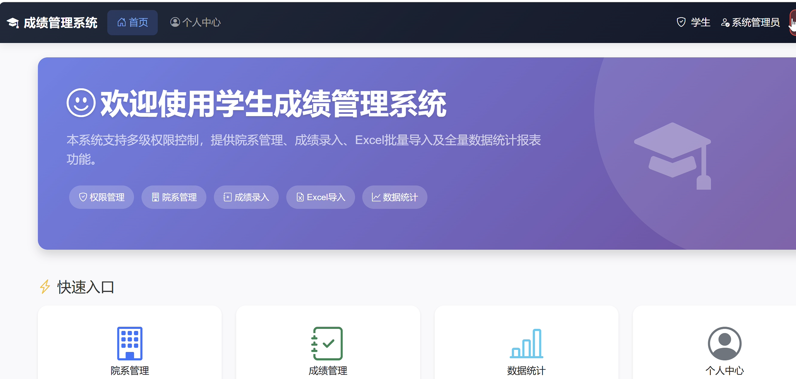

# student-management-platform

基于 Flask + SQL Server 的高校学籍管理系统

## ✨ 项目功能

- 用户登录权限校验
- 学生信息新增、查询、修改、删除
- Excel 批量导入、导出学生数据
- 数据持久化存储于 SQL Server 数据库

## 🛠️ 技术栈

Python / Flask / pyodbc / openpyxl / SQL Server

## 🚀 本地运行步骤

```cmd
D:
cd D:\数据库\数据库\StudentSystem
.venv\Scripts\activate.bat
pip install flask pyodbc openpyxl
python app.py
```

访问地址：http://127.0.0.1:5000

## 🎬 系统演示视频

[](https://www.bilibili.com/video/BV1DSsh6iENu?vd_source=5ae0b2d3e3e362449afe45264a35e13b)

视频直达链接：https://www.bilibili.com/video/BV1DSsh6iENu?vd_source=5ae0b2d3e3e362449afe45264a35e13b

## 📁 项目结构

```
student-management-platform/
├── app.py                  # Flask 主程序
├── static/                 # 静态资源（CSS、JS）
├── templates/              # HTML 页面模板
├── demo.png                # 演示封面图
├── StudentSystem.zip       # 源码压缩包
└── 吴文恬-高校学籍管理系统.docx   # 课程设计报告
```

## 📄 配套文档

课程设计报告：[吴文恬-高校学籍管理系统.docx](./吴文恬-高校学籍管理系统.docx)

打包源码下载：[StudentSystem.zip](./StudentSystem.zip)

> （注：部分内容由豆包 AI 生成）
